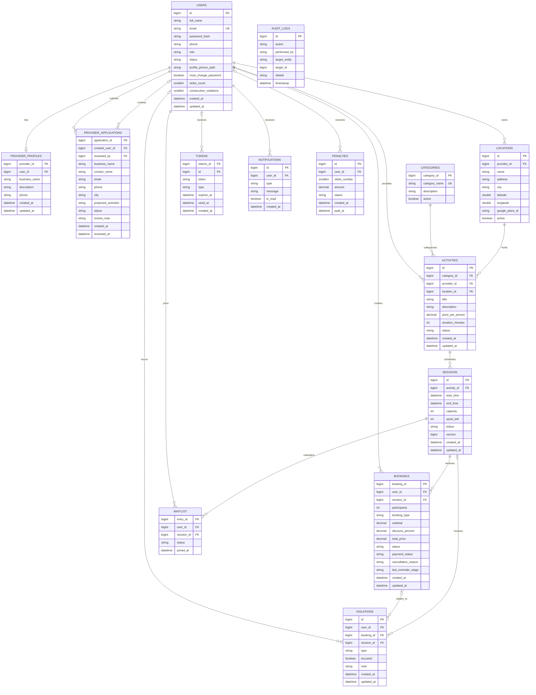

# BookNGo — Activities & Experiences Booking Platform

BookNGo is a full-stack activities and experiences booking platform developed using **Java, Spring Boot, PostgreSQL, and React**. The platform connects customers with activity providers, allowing users to discover experiences, reserve available sessions, and manage their bookings.
The project was developed as part of the **General Assembly Java Development Bootcamp Projects 02 & 03**

Project 3 builds on the existing application by introducing thread-safe booking operations, automatic waitlist allocation, asynchronous notifications, and Google Maps integration.

# Part 1 — Project Overview

## 1.1 Project Objectives

BookNGo aims to provide a centralized platform for discovering and booking activities while maintaining a secure, reliable, and user-friendly experience.

The main objectives are to:

- Allow customers to explore activities and reserve available sessions.
- Enable providers to manage their activities, locations, and schedules.
- Provide administrators with tools to manage users, provider applications, and platform violations.
- Enforce real-world booking rules such as capacity limits, duplicate booking prevention, and cancellation restrictions.
- Maintain data consistency when multiple users interact with the system simultaneously.
- Deliver notifications and booking updates without unnecessarily blocking user requests.
- Integrate external services to improve location accuracy and customer experience.

## 1.2 User Roles

BookNGo supports three main roles:

| Role | Description | Main Capabilities |
|---|---|---|
| `USER` | Customer | Explore activities, book sessions, manage bookings, join waitlists, receive notifications |
| `PROVIDER` | Activity provider | Manage activities, sessions, locations, and provider profile |
| `ADMIN` | Platform administrator | Review provider applications, manage users and roles, monitor violations and penalties, view audit logs |

Activity browsing is publicly accessible. Authentication is required for reservations, waitlist operations, profile management, and other protected actions.

## 1.3 Technology Stack

| Category | Technologies |
|---|---|
| Backend | Java 17, Spring Boot 4.1.1 |
| Frontend | React 19, Vite, JavaScript, CSS |
| Database | PostgreSQL |
| ORM | Spring Data JPA, Hibernate |
| Authentication & Security | Spring Security, JWT, BCrypt |
| API | RESTful APIs, Spring Web MVC |
| API Documentation | Springdoc OpenAPI, Swagger UI |
| Concurrency | Java `ExecutorService`, `CountDownLatch`, Spring Transactions, JPA Pessimistic Locking |
| Asynchronous Processing | Spring `@Async`, `ThreadPoolTaskExecutor`, Application Events |
| Real-Time Communication | Server-Sent Events (SSE) |
| Email | Spring Mail |
| Maps & Geolocation | Google Maps JavaScript API, Google Geocoding API |
| Testing | JUnit 5, Mockito, Spring Boot Test, PostgreSQL Integration Tests, Vitest, React Testing Library |
| Build & Development | Maven, npm, IntelliJ IDEA, Git, GitHub |
| Planning & Design | Trello, dbdiagram.io |

## 1.4 System Architecture

The backend follows a layered architecture:

```text
                        React Frontend
                              |
                              v
                       REST Controllers
                              |
                              v
                       Service Layer
                              |
                 +------------+------------+
                 |                         |
                 v                         v
             Repositories             Integrations
                 |                         |
                 v                +--------+--------+
             PostgreSQL           |                 |
                               Google Maps       Email/SSE
```

### Backend Layers

- **Controller Layer:** Defines REST endpoints, receives HTTP requests, and validates request data.
- **Service Layer:** Implements business rules, authorization checks, transactions, and application workflows.
- **Repository Layer:** Handles database access using Spring Data JPA.
- **Model Layer:** Defines JPA entities, DTOs, and enumerations.
- **Security Layer:** Handles JWT authentication, authorization, and role-based access control.
- **Configuration Layer:** Configures application security, asynchronous execution, Swagger, rate limiting, and development data.
- **Exception Handling:** Centralizes error responses for validation, authorization, conflicts, and external API failures.

The frontend communicates with the backend through REST APIs and receives live notifications through SSE.

## 1.5 Database Design & ERD

BookNGo uses PostgreSQL as its relational database.

The current domain model contains **14 JPA entities**, supporting authentication, provider management, activity scheduling, bookings, waitlists, notifications, and administrative operations.

The ERD below reflects the database model after the Project 3 additions.

### Complete ERD — Project 2 + Project 3



### Main Relationships

| Relationship | Description |
|---|---|
| User → Bookings | A customer can have multiple bookings |
| User → ProviderProfile | A provider has one provider profile |
| Provider → Activities | A provider can manage multiple activities |
| Provider → Locations | A provider can own multiple locations |
| Category → Activities | A category can contain multiple activities |
| Location → Activities | A location can host multiple activities |
| Activity → Sessions | An activity can have multiple scheduled sessions |
| Session → Bookings | A session can have multiple bookings |
| Session → Waitlist | A session can have multiple waiting customers |
| User → Waitlist | A customer can join waitlists for eligible sessions |
| User → Notifications | A user can receive multiple notifications |

## 1.6 Project Structure

```text
BookNGo/
|
|-- frontend/
|   |-- src/
|   |   |-- components/
|   |   |-- pages/
|   |   |-- utils/
|   |   |-- api.js
|   |   |-- App.jsx
|   |-- package.json
|   |-- MAPS.md
|
|-- src/
|   |-- main/
|   |   |-- java/com/project/bookngo/
|   |   |   |-- config/
|   |   |   |-- controller/
|   |   |   |-- exception/
|   |   |   |-- model/
|   |   |   |   |-- enums/
|   |   |   |   |-- request/
|   |   |   |   |-- response/
|   |   |   |-- repository/
|   |   |   |-- security/
|   |   |   |-- service/
|   |   |   |   |-- event/
|   |   |   |-- utilities/
|   |   |   |-- BookngoApplication.java
|   |   |-- resources/
|   |       |-- application.properties
|   |
|   |-- test/
|       |-- java/com/project/bookngo/
|           |-- concurrency/
|           |-- service/
|
|-- pom.xml
|-- mvnw
|-- mvnw.cmd
|-- README.md
```

## 1.7 Main API Endpoints

The table below highlights the main APIs used by BookNGo. It is **not an exhaustive endpoint reference**.

| Method | Endpoint | Description |
|---|---|---|
| `POST` | `/api/auth/register` | Register a customer |
| `POST` | `/api/auth/login` | Authenticate and obtain a JWT |
| `GET` | `/api/activities` | Browse activities |
| `GET` | `/api/activities/{activity_id}` | View activity details |
| `POST` | `/api/activities` | Create a provider activity |
| `GET` | `/api/sessions/activity/{activityId}` | View sessions for an activity |
| `POST` | `/api/bookings` | Create a booking |
| `GET` | `/api/bookings` | View personal bookings |
| `DELETE` | `/api/bookings/{id}` | Cancel a booking |
| `POST` | `/api/sessions/{sessionId}/waitlist` | Join an eligible session waitlist |
| `GET` | `/api/sessions/{sessionId}/waitlist/me` | View personal waitlist entry |
| `POST` | `/api/locations` | Create a provider location |
| `PATCH` | `/api/locations/{id}/pin` | Save manually selected map coordinates |
| `GET` | `/api/notifications` | Retrieve notifications |
| `GET` | `/api/notifications/subscribe` | Subscribe to SSE notifications |
| `POST` | `/api/applications` | Submit a provider application |

### Complete API Documentation — Swagger

The complete API documentation, including the remaining endpoints, request/response DTOs, and available operations, can be accessed using Swagger UI:

**Swagger UI:** http://localhost:8080/swagger-ui/index.html

---

# Part 2 — Project 2: Secure Spring Boot REST API

## 2.1 Project 2 Overview

Project 2 focused on developing a secure and functional REST API using Spring Boot.

The main objective was to establish the platform's core architecture, database entities, authentication system, role-based authorization, and business workflows.

A React frontend was also developed to provide a user interface for the backend functionality.

## 2.2 Authentication & User Management

BookNGo implements JWT-based authentication using Spring Security.

### Implemented Features

- User registration and login.
- Password hashing using BCrypt.
- JWT generation and validation.
- Email verification following registration.
- Password change and recovery workflows.
- User profile viewing and editing.
- Profile picture uploads.
- User role and account status management.
- Role-based and method-level access restrictions.

### Security Approach

The application uses stateless authentication.

For protected endpoints, the frontend provides the JWT in the HTTP request header:

```http
Authorization: Bearer <JWT_TOKEN>
```

Spring Security processes the token and determines whether the authenticated user has permission to access the requested operation.

Public activity discovery remains available without authentication, while actions such as booking, waitlist management, and provider administration require authentication.

## 2.3 Activity & Category Management

Providers can manage activities available on the platform.

### Business Rules

- Only authorized providers can manage their activities.
- Activities belong to a specific provider.
- Activities are assigned to categories.
- Activities are associated with physical locations.
- Activity records can be updated or deactivated according to application rules.

Customers can browse activity listings and view activity details through the React frontend.

## 2.4 Session Management

An activity can contain multiple scheduled sessions.

Each session stores:

- Start and end times.
- Total capacity.
- Remaining available spots.
- Session status.
- Associated activity.
- 
### Business Rules

- End time must be later than start time.
- Providers can only manage sessions belonging to their activities.
- Session capacity cannot be modified when existing bookings make the change invalid.
- Sessions that have started or finished cannot be edited or cancelled contrary to business rules.
- Cancelled sessions cannot be edited.
- Session modifications are restricted by the configured 24-hour scheduling rule.

Project 3 later strengthened these operations using transactions, ownership checks, and pessimistic locking.

## 2.5 Booking Management

Customers can reserve places in scheduled activity sessions.

### Booking Information

Each booking stores:

- Customer.
- Session.
- Number of participants.
- Booking type.
- Subtotal and total price.
- Booking status.
- Payment status.
- Creation and modification timestamps.

### Booking Rules

- A customer cannot create duplicate confirmed bookings for the same session.
- A booking cannot exceed the number of available seats.
- Sessions that have already started cannot be booked.
- Cancelled or completed sessions are unavailable for booking.
- The booking subtotal is calculated from the activity price and participant count.
- Successful bookings reduce the session's available capacity.
- Booking cancellations follow session timing and status restrictions.

Booking operations were later extended in Project 3 to protect shared capacity from concurrent requests.

**Payment status tracking is implemented; a complete external payment gateway is not part of this implementation.**

## 2.6 Provider Registration & Approval

BookNGo supports an application workflow for customers interested in becoming activity providers.

### Workflow

1. A user submits a provider application.
2. The application is stored with a pending status.
3. Administrators can review submitted applications.
4. An administrator approves or rejects the application.
5. Approved providers can manage provider-specific resources according to their assigned permissions.

Provider applications contain contact information, business details, a description, and proposed activities.

A separate provider profile stores business-specific information.

## 2.7 Administration & Audit Logging

Administrators have access to platform management functionality.

### Administrative Capabilities

- Review provider applications.
- Approve or reject applications.
- Manage user roles.
- Deactivate user accounts.
- Review audit logs.
- Support violation and penalty management.

### Audit Logs

The application stores administrative and relevant business actions using audit records containing:

- Action performed.
- User responsible.
- Target entity.
- Target identifier.
- Additional details.
- Timestamp.

Audit logging helps track important application operations.

## 2.8 Violations, Strikes & Penalties

BookNGo includes a penalty management system for handling customer violations.

The system supports:

- Recording booking- or session-related violations.
- Maintaining user strike counts.
- Tracking consecutive violations.
- Creating penalties when applicable.
- Recording penalty status and payment information.
- Allowing authorized users to review and manage violations.

This functionality supports the platform's business policies and administrative oversight.

## 2.9 Notifications & Email Services

The original application includes notification and email capabilities.

### Implemented Features

- Email verification.
- Password recovery emails.
- Booking-related email notifications.
- Scheduled booking reminders.
- Stored in-app notifications.
- Server-Sent Events for real-time notification updates.

Project 3 later improved the notification architecture by introducing asynchronous processing and transaction-aware event listeners.

## 2.10 Additional Backend Features

Other implemented functionality includes:

- DTO-based request and response handling.
- Input validation using Jakarta Bean Validation.
- Centralized exception handling.
- Pagination and sorting for supported endpoints.
- API rate limiting.
- File upload support for profile pictures.
- Database seeding for development and demonstrations.
- Swagger/OpenAPI documentation.

## 2.11 React Frontend

Although the primary focus of Project 2 was the backend REST API, BookNGo also includes a React frontend.

The application provides interfaces for:

- Registration and login.
- Public activity discovery.
- Activity details and available sessions.
- Booking creation and management.
- User profile management.
- Provider applications.
- Provider activity and session management.
- Administrative operations.
- In-app notifications.

The frontend communicates with Spring Boot using Axios and stores the authentication state required for protected operations.

---

# Part 3 — Project 3: Concurrency & Multithreading

## 3.1 Project 3 Overview

Project 3 extends the existing BookNGo application to address concurrency, multithreading, asynchronous execution, and external API integration.
The main challenge was to ensure that multiple users could interact with the booking system simultaneously without causing incorrect reservations or database inconsistencies.

### Main Additions

1. Thread-safe booking operations.
2. Prevention of booking race conditions.
3. Automatic FIFO waitlist allocation.
4. Safe handling of simultaneous booking cancellations.
5. Thread-pool-based asynchronous notification processing.
6. Transaction-safe email and SSE event handling.
7. Google Maps and Geocoding API integration.
8. Provider-controlled draggable location markers.
9. Automated concurrency and integration testing.

## 3.2 Concurrency Problem — Race Conditions

### Identified Problem

A race condition can occur when two customers attempt to book the last available seat in the same session.

Without appropriate synchronization, both requests could read the same capacity before either transaction updates it.

### Example

**Initial condition:**

```text
Session capacity:      1
Available spots:       1
Confirmed bookings:    0
```

Two customers send booking requests simultaneously.

**Potential behavior without concurrency control:**

```text
Customer A reads: 1 available seat
Customer B reads: 1 available seat

Customer A attempts to create a booking
Customer B attempts to create a booking

Both requests may succeed if the shared state
is not protected correctly.
```

### Potential Consequences

- Session overbooking.
- Incorrect remaining capacity.
- Duplicate allocation of a limited resource.
- Inconsistent booking records.
- Unreliable booking confirmations.

## 3.3 Solution — Pessimistic Database Locking

BookNGo prevents concurrent capacity updates using **PostgreSQL row-level locking through Spring Data JPA**.

### Technologies Used

- `@Transactional`
- `@Lock(LockModeType.PESSIMISTIC_WRITE)`
- PostgreSQL transactions
- Spring Data JPA
- Hibernate

The session repository provides a locking method used by booking-related operations.

```java
@Lock(LockModeType.PESSIMISTIC_WRITE)
@Query("SELECT s FROM Sessions s WHERE s.id = :id")
Optional<Sessions> findByIdForUpdate(@Param("id") Long id);
```

### How It Works

1. Customer A begins a booking transaction.
2. Customer A acquires a pessimistic write lock on the session row.
3. Customer B attempts to acquire the same lock.
4. Customer B waits while Customer A's transaction holds the lock.
5. Customer A validates capacity, creates the booking, and updates the session.
6. Customer A's transaction completes and releases the lock.
7. Customer B obtains the lock and evaluates the updated availability.
8. If no seats remain, Customer B's booking is rejected.

### Expected Outcome

| Request | Result |
|---|---|
| Customer A | `201 Created` |
| Customer B | `409 Conflict` |

The successful request reserves the available seat. The conflicting request cannot create an additional booking beyond the session capacity.

### Why Database Locking?

Database-level locking was selected because booking capacity is shared across application requests and must remain consistent even when multiple threads access the same session.

Unlike synchronizing only Java methods, a PostgreSQL transaction lock protects the shared database row across separate application requests and transactions.

## 3.4 Thread-Safe Booking Operations

The concurrency improvements were integrated into the existing booking services.

### Protected Operations

- Creating bookings.
- Cancelling bookings.
- Restoring released capacity.
- Allocating available seats to waiting customers.
- Updating and cancelling sessions.

### Transactional Consistency

Booking creation, capacity changes, and related database updates occur within transactions.

If a transaction fails, its uncommitted database changes are rolled back.

This prevents a failed booking operation from leaving partial changes to session availability.

### Duplicate Cancellation Protection

A second race condition occurs when two requests attempt to cancel the same booking simultaneously.

Without proper protection, the system could incorrectly restore the reserved seats more than once.

BookNGo handles this by locking the related session, refreshing the booking state, and validating that the booking has not already been cancelled.

**Expected result:** Only one cancellation changes the booking and restores its capacity.

## 3.5 Automatic Waitlist System

A significant Project 3 addition is the automatic waitlist.

Customers can join a waitlist when a session is fully booked and eligible for waiting-list registration.

### New Entity — `WaitlistEntry`

The waitlist is persisted in the `waitlist` table.

| Field | Purpose |
|---|---|
| `entry_id` | Unique waitlist entry identifier |
| `user_id` | Customer waiting for a place |
| `session_id` | Requested session |
| `status` | Current waitlist status |
| `joined_at` | Time the customer joined |

### Waitlist Statuses

- `WAITING`
- `BOOKED`
- `CANCELLED`
- `EXPIRED`

### Business Rules

- Customers cannot join the same session waitlist multiple times while already waiting.
- Customers with a confirmed booking for the session cannot create an additional waiting entry.
- Waitlist entries are processed using **FIFO** ordering.
- Booking allocation prioritizes eligible waiting customers.
- Seat allocation respects the session's remaining capacity.
- Waitlist operations use the session's database lock to protect shared state.

## 3.6 Automatic Seat Allocation

When a confirmed booking is cancelled, BookNGo can automatically allocate the newly available capacity to the next eligible customer in the waitlist.

### Allocation Workflow

```text
Customer cancels booking
          |
          v
Lock session inside transaction
          |
          v
Mark booking as CANCELLED
          |
          v
Restore released capacity
          |
          v
Check waiting customers in FIFO order
          |
          v
Select next eligible customer
          |
          v
Create confirmed booking
          |
          v
Update waitlist status to BOOKED
          |
          v
Update session availability
          |
          v
Commit transaction
          |
          v
Process notification asynchronously
```

### Example

A session contains one confirmed booking, with two customers waiting:

```text
1. Sara — WAITING
2. Ali  — WAITING
```

When the original customer cancels:

```text
Sara — BOOKED
Ali  — WAITING
```

Sara receives the available seat because she joined first.

If additional seats become available through separate cancellations, the allocation process continues according to eligibility and FIFO ordering.

### Concurrency Protection

Automatic allocation is coordinated with the booking cancellation transaction.

This ensures that simultaneous cancellations do not allocate the same available seat to more than one customer.

## 3.7 Multithreading & Thread Pooling

Project 3 also introduces asynchronous processing using a dedicated Spring-managed thread pool.

### Configuration

The application defines a `ThreadPoolTaskExecutor` named `notificationExecutor`.

```java
@Bean(name = "notificationExecutor")
public ThreadPoolTaskExecutor notificationExecutor() {
    ThreadPoolTaskExecutor executor = new ThreadPoolTaskExecutor();

    executor.setCorePoolSize(2);
    executor.setMaxPoolSize(4);
    executor.setQueueCapacity(50);
    executor.setThreadNamePrefix("bookngo-notify-");

    executor.setWaitForTasksToCompleteOnShutdown(true);
    executor.setAwaitTerminationSeconds(20);

    return executor;
}
```

The configuration also enables asynchronous execution using `@EnableAsync`.

### Benefits

- Allows notification tasks to run on worker threads.
- Reduces the amount of notification work performed directly in the HTTP request flow.
- Reuses a controlled number of threads.
- Provides a queue for pending notification tasks.
- Supports asynchronous email and SSE processing.

The application uses Spring's `ThreadPoolTaskExecutor` for background notifications, while concurrency tests use Java's `ExecutorService` to simulate multiple users.

## 3.8 Event-Driven Booking Notifications

BookNGo uses Spring application events to separate booking operations from notification processing.

### Main Components

| Component | Responsibility |
|---|---|
| `BookingNotificationEvent` | Represents a booking-related notification event |
| `BookingNotificationType` | Defines confirmation, cancellation, and waitlist event types |
| `BookingNotificationListener` | Processes booking-related emails asynchronously |
| `NotificationCreatedEvent` | Represents a newly persisted in-app notification |
| `NotificationSseListener` | Sends SSE updates asynchronously |
| `NotificationAsyncConfig` | Configures the dedicated notification thread pool |

### Booking Event Types

- `BOOKING_CONFIRMED`
- `BOOKING_CANCELLED`
- `WAITLIST_ALLOCATED`

### Event Processing

Booking and waitlist services publish application events after performing their database operations.

The listeners use:

```java
@Async("notificationExecutor")
@TransactionalEventListener(
    phase = TransactionPhase.AFTER_COMMIT
)
```

### Why `AFTER_COMMIT`?

A notification should not be sent to a customer if the related database transaction fails.

For example, sending a booking confirmation before the transaction commits could result in a customer receiving a confirmation for a booking that was eventually rolled back.

Using `AFTER_COMMIT` ensures that the event listener is triggered only after a successful transaction commit.

### Expected Behavior

| Transaction Result | Notification Behavior |
|---|---|
| Booking transaction commits | Confirmation processing is triggered |
| Booking transaction rolls back | Confirmation processing is not triggered |
| Cancellation commits | Cancellation email processing is triggered |
| Waitlist allocation commits | Waitlist confirmation processing is triggered |

Notification delivery failures are logged by the asynchronous listeners without reversing an already committed booking transaction.

## 3.9 Transaction-Safe Real-Time Notifications

BookNGo uses Server-Sent Events (SSE) to communicate notification updates to connected clients.

Project 3 extends the original implementation by making SSE dispatch asynchronous and transaction-aware.

### Workflow

1. An in-app notification is created within a database transaction.
2. A `NotificationCreatedEvent` is published.
3. The transaction commits successfully.
4. `NotificationSseListener` processes the event asynchronously.
5. The SSE service sends the notification to connected clients.

### Benefits

- Prevents notifications from being broadcast for rolled-back transactions.
- Separates database persistence from network delivery.
- Allows notification updates without refreshing the frontend.
- Avoids performing SSE broadcasting directly inside the original business transaction.

## 3.10 Google Maps Integration

Project 3 integrates **Google Maps Platform** to improve the accuracy and usability of physical activity locations.

### Technologies

- Google Geocoding API.
- Google Maps JavaScript API.
- `@vis.gl/react-google-maps`.
- Java `HttpClient`.
- Spring Boot environment-based configuration.

### Backend Geocoding

When a provider creates a location or changes its address, the backend sends the address to Google's Geocoding API.

The response provides geographic information, including:

- Latitude.
- Longitude.
- Google Place ID, when available.

This information is stored with the corresponding location.

### Updated Location Model

Project 3 extends location information with:

```text
Location
|-- id
|-- name
|-- address
|-- city
|-- latitude
|-- longitude
|-- googlePlaceId
|-- active
|-- provider
```

### Google API Error Handling

The backend handles cases such as:

- Invalid or unresolved addresses.
- Google API request failures.
- Unexpected API responses.
- Network communication errors.
- Missing API configuration.

External API failures are handled through the application's centralized exception-handling mechanism.

## 3.11 Interactive Map Pin Editing

Providers can manually adjust the position of their activity center using an interactive Google Map.

This feature addresses cases where address-based geocoding places the marker at an approximate location rather than the exact activity center.

### Features

- View a saved location on Google Maps.
- Open an editable map.
- Drag a marker to the desired location.
- Zoom in to select a precise position.
- Switch between roadmap and satellite views.
- Enter coordinates manually when needed.
- Preview changes before saving.
- Save or cancel the edited position.

### Backend Endpoint

```http
PATCH /api/locations/{id}/pin
```

Example request:

```json
{
  "latitude": 26.2376177,
  "longitude": 50.5734496
}
```

### Business Rules

- Only authorized providers can update their own locations.
- The selected coordinates are saved in PostgreSQL.
- Manual pin updates do not re-run forward geocoding.
- Existing activity relationships are preserved.
- A previous Google Place ID is cleared when it no longer represents a verified match for the manually selected coordinates.

The updated coordinates are used when customers view the activity location and open directions.

### API Key Security

Separate API keys are used for frontend map rendering and backend geocoding.

- The backend key is configured outside the committed source code.
- The browser key is restricted by allowed websites and permitted APIs.
- Frontend configuration uses `VITE_GOOGLE_MAPS_API_KEY`.
- Backend configuration uses `GOOGLE_MAPS_API_KEY`.

Before production deployment, Google Maps data-storage terms, API restrictions, and usage quotas should be reviewed.

## 3.12 Testing Strategy

Project 3 includes automated tests covering concurrency, transaction consistency, asynchronous processing, and location management.

### Testing Technologies

- JUnit 5.
- Mockito.
- Spring Boot Test.
- PostgreSQL.
- `ExecutorService`.
- `CountDownLatch`.
- HTTP integration tests.
- Vitest and React Testing Library.

### Unit Tests

Unit tests verify isolated service behavior using mocks where appropriate.

Examples include:

- Booking validations.
- Waitlist eligibility and allocation behavior.
- Google Geocoding API response handling.
- Location creation and updates.
- Manual pin validation and authorization.
- Authentication-related service behavior.

### Integration Tests

Integration tests exercise multiple application components together, including Spring transactions and PostgreSQL.

**Main test classes:**

- `BookingConcurrencyIntegrationTest.java`
- `NotificationAfterCommitIntegrationTest.java`
- `LocationPinPersistenceTest.java`

### Concurrency Test Scenarios

| Test Scenario | Expected Result |
|---|---|
| Two customers book the last seat simultaneously | Exactly one booking succeeds |
| Two HTTP booking requests compete for one seat | One HTTP 201 and one HTTP 409 |
| Two cancellations release seats simultaneously | Capacity and waitlist allocations remain consistent |
| A booking cancellation releases one seat | The first eligible waitlisted customer receives it |
| Two requests cancel the same booking | Capacity is restored only once |
| Booking transaction rolls back | No confirmation email is triggered |
| Booking transaction commits | Confirmation email processing is triggered |
| Notification transaction rolls back | No SSE notification is broadcast |
| Notification transaction commits | SSE broadcasting is triggered |

### Concurrency Test Execution

Concurrency tests use Java's `ExecutorService` to execute multiple tasks and `CountDownLatch` to coordinate their start.

Example:

```java
ExecutorService executor =
        Executors.newFixedThreadPool(2);

CountDownLatch ready =
        new CountDownLatch(2);

CountDownLatch start =
        new CountDownLatch(1);
```

The workers signal when they are ready, then wait for the shared start signal before attempting the concurrent operation.

This approach creates a controlled contention scenario without relying on arbitrary `Thread.sleep()` delays.

### Test Results

The final automated test suite was executed successfully during development.

The main concurrency tests verify that the system prevents overbooking, preserves session capacity, respects FIFO waitlist ordering, and avoids duplicate cancellation effects.

## 3.13 Project 3 Summary

Project 3 extends BookNGo beyond a traditional booking REST API by introducing concurrency protection and asynchronous processing into real business workflows.

### Key Outcomes

- Prevented concurrent requests from overbooking activity sessions.
- Protected session capacity using PostgreSQL pessimistic locking.
- Implemented transaction-safe booking cancellations.
- Introduced an automatic FIFO waitlist.
- Prevented released capacity from being allocated more than once.
- Used a dedicated thread pool for asynchronous notification processing.
- Used transaction-aware listeners to prevent notifications for rolled-back operations.
- Improved real-time updates using asynchronous SSE delivery.
- Integrated Google Maps and real address geocoding.
- Added precise, provider-controlled draggable location markers.
- Verified important scenarios through automated unit and integration tests.

These additions improve the reliability, consistency, responsiveness, and functionality of BookNGo while preserving the application developed in Project 2.

---

# Installation & Running the Project

## Prerequisites

Ensure the following tools are installed:

- Java JDK 17.
- PostgreSQL.
- Node.js and npm.
- Git.
- IntelliJ IDEA or another Java IDE.

Maven installation is optional because the project includes the Maven Wrapper.

## 1. Clone the Repository

```bash
git clone https://github.com/ftmaalt/EventBookingSystem.git
cd EventBookingSystem
```

## 2. Configure the Database

Create a PostgreSQL database for development, for example:

```sql
CREATE DATABASE bookngo;
```

Configure your local Spring Boot development properties with the appropriate database credentials.

The repository uses the `dev` profile through `application.properties`.

Sensitive development settings should be kept in a local, untracked `application-dev.properties` file.

Example configuration:

```properties
spring.datasource.url=${DB_URL:jdbc:postgresql://localhost:5432/bookngo}
spring.datasource.username=${DB_USERNAME:postgres}
spring.datasource.password=${DB_PASSWORD}

jwt-secret=${JWT_SECRET}

spring.mail.host=smtp.gmail.com
spring.mail.port=587
spring.mail.username=${MAIL_USERNAME}
spring.mail.password=${MAIL_PASSWORD}
spring.mail.properties.mail.smtp.auth=true
spring.mail.properties.mail.smtp.starttls.enable=true

google.maps.api-key=${GOOGLE_MAPS_API_KEY:}
```

Set the referenced environment variables in your local environment or IntelliJ run configuration.

Other application settings, such as file storage, Hibernate schema management, mail behavior, and JWT expiration, should match the project's configured development profile.

**Do not commit real passwords, API keys, or JWT secrets.**

## 3. Run the Backend

On Windows:

```powershell
.\mvnw.cmd spring-boot:run
```

On macOS/Linux:

```bash
./mvnw spring-boot:run
```

The backend runs at:

http://localhost:8080

### Development Seed Data

`DataSeeder.java` provides development demonstration data when the `dev` profile is active.

The seeder creates sample users, providers, categories, locations, activities, sessions, and bookings.

It skips the seed operation when users already exist in the database, preventing an ordinary restart from recreating the demo data.

## 4. Configure the Frontend

Inside the `frontend` directory, create a local `.env.local` file.

Example:

```dotenv
VITE_API_URL=http://localhost:8080
VITE_GOOGLE_MAPS_API_KEY=your_browser_restricted_key
VITE_GOOGLE_MAPS_MAP_ID=your_optional_map_id
```

The Google Maps browser key must be configured with appropriate website and API restrictions.

The map ID is optional for the existing implementation.

## 5. Run the Frontend

```bash
cd frontend
npm install
npm run dev
```

Open the local address displayed by Vite.

The frontend and backend should both be running to use the complete application.

## 6. Run the Tests

### Backend

Use a **separate PostgreSQL test database** and configure the test profile before running database integration tests.

Windows:

```powershell
.\mvnw.cmd test
```

macOS/Linux:

```bash
./mvnw test
```

### Frontend

```bash
cd frontend
npm test
npm run build
```

These commands run the frontend tests and create the production build.

---

# Project Resources

- **GitHub Repository:** [https://github.com/ftmaalt/EventBookingSystem]
- **Trello User Stories:** [https://trello.com/b/WOpNyReb/project2-user-stories]
- **Trello Planning Board:** [https://trello.com/b/gYvDWs6d/project2-planning]
- **Swagger UI:** [http://localhost:8080/swagger-ui/index.html]
- **OpenAPI Specification:** [http://localhost:8080/v3/api-docs]
- **Google Maps Setup & Testing:** [frontend/MAPS.md](frontend/MAPS.md)

---

# Conclusion

BookNGo demonstrates the development of a full-stack activity booking platform with secure REST APIs, role-based access, database persistence, and practical booking business rules.

Project 2 established the platform's core functionality, while Project 3 focused on improving reliability under concurrent requests and extending the application through asynchronous processing and third-party API integration.

The final application demonstrates how **transactions, database locking, thread pooling, application events, and integration testing** can be applied to solve real-world problems in an activity reservation system.
