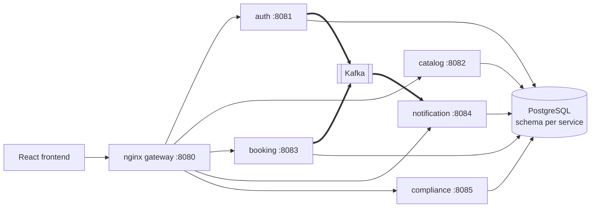

# BookNGo — Activities & Experiences Booking Platform

**Docs:**
[Architecture](docs/architecture.md) ·
[Deployment](docs/deployment.md) ·
[Kafka events](docs/kafka-events.md) ·
[Caching](docs/caching.md) ·
[Demo data](docs/seed-data.md) ·
[Database & ERD](docs/database-erd.md) ·
[Phase 1 – Project 2](docs/phase-1-project2.md) ·
[Phase 2 – Project 3](docs/phase-2-project3.md)
**Project:** [Trello user stories](https://trello.com/b/WOpNyReb/project2-user-stories) ·
[Trello Project 4 plan](https://trello.com/b/Pr7szEG4/project-4-plan) ·
[Jenkins setup](jenkins/README.md) ·
[Google Maps setup](frontend/MAPS.md) ·
[GitHub](https://github.com/ftmaalt/EventBookingSystem)

---

BookNGo is a full-stack platform where customers discover activities and experiences, book sessions, and join waitlists, and providers publish and manage them. It was built as General Assembly Java Development Bootcamp Projects 2, 3 and 4.

| Phase | Focus | Docs |
|---|---|---|
| 1 — Project 2 | Secure REST API, roles, bookings, provider approval, violations | [phase-1-project2.md](docs/phase-1-project2.md) |
| 2 — Project 3 | Concurrency, waitlist, async events, Google Maps | [phase-2-project3.md](docs/phase-2-project3.md) |
| 3 — Project 4 | Microservices, Docker, Kafka, Jenkins CI/CD, AWS | [architecture.md](docs/architecture.md), [deployment.md](docs/deployment.md), [kafka-events.md](docs/kafka-events.md) |

## User roles

| Role | Capabilities |
|---|---|
| `USER` (customer) | Browse activities, book sessions, cancel, join waitlists, receive notifications |
| `PROVIDER` | Manage activities, locations and sessions |
| `ADMIN` | Review provider applications, manage users, audit logs |

Browsing is public; everything else needs a JWT.

## Architecture at a glance

Five Spring Boot services behind an nginx gateway, one PostgreSQL database with one schema per service, and Kafka for asynchronous events.



| Service | Port | Responsibility |
|---|---|---|
| auth-service | 8081 | Registration, login, roles, provider applications |
| catalog-service | 8082 | Categories, locations, activities (cached) |
| booking-service | 8083 | Sessions, bookings, waitlist, concurrency control |
| notification-service | 8084 | Kafka consumer, in-app (SSE) and email notifications |
| compliance-service | 8085 | Violations, strikes, penalties |

Full detail, diagrams and workflows: [docs/architecture.md](docs/architecture.md).

## Technology stack

| Category | Technologies |
|---|---|
| Backend | Java 17, Spring Boot, Spring Data JPA, Hibernate, Maven |
| Security | Spring Security, JWT, BCrypt, login rate limiting |
| Frontend | React 19, Vite |
| Database | PostgreSQL 16, Flyway migrations |
| Messaging | Apache Kafka 3.9 (KRaft), dead-letter topics |
| Concurrency | JPA pessimistic locking, `ThreadPoolTaskExecutor`, transactional events |
| Caching | Spring Cache with Caffeine |
| Real time & email | Server-Sent Events, Spring Mail |
| Maps | Google Maps JavaScript and Geocoding APIs |
| API docs | Springdoc OpenAPI (Swagger UI on each service) |
| Containers | Docker, Docker Compose, nginx gateway |
| CI/CD | Jenkins, Docker Hub (GitHub Actions workflow as an extra) |
| Cloud | AWS EC2, RDS PostgreSQL, CloudWatch Logs |
| Testing | JUnit 5, Mockito, Spring Boot Test, Vitest, React Testing Library |

## Quick start (local)

Prerequisites: Docker with Compose, Node.js 18+ (frontend and seed script).

1. Create a `.env` file in the repo root (never commit it):

   ```dotenv
   DB_PASSWORD=choose-a-password
   JWT_SECRET=a-long-random-string
   INTERNAL_API_KEY=another-random-string
   # optional
   GOOGLE_MAPS_API_KEY=
   MAIL_ENABLED=false
   ```

2. Start the backend:

   ```bash
   docker compose up -d --build
   ```

   The API is available through the gateway at `http://localhost:8080`. Kafka UI runs at `http://localhost:8090`.

3. Start the frontend:

   ```bash
   cd frontend
   echo VITE_API_URL=http://localhost:8080 > .env.local
   npm install
   npm run dev
   ```

4. Optional demo data (admin, providers, customers, activities, sessions, bookings):

   ```bash
   # enable the seeder once: add SEED_ENABLED=true and SEED_PASSWORD=<password> to .env,
   # then: docker compose up -d auth-service
   SEED_PASSWORD=<password> node scripts/seed-demo-data.mjs
   ```

   Set `SEED_ENABLED=false` afterwards. The script is safe to run twice. Accounts and details: [docs/seed-data.md](docs/seed-data.md).

Swagger UI per service: `http://localhost:8081/swagger-ui/index.html` (auth), `8082` (catalog), `8083` (booking), `8084` (notification), `8085` (compliance).

## Tests

```bash
./mvnw test                      # backend (Windows: .\mvnw.cmd test)
cd frontend && npm test          # frontend
```

## Repository layout

```text
auth-service/  catalog-service/  booking-service/
notification-service/  compliance-service/   Spring Boot services
gateway/                                     nginx.conf
frontend/                                    React app
scripts/                                     demo data seeder
docs/                                        architecture, deployment, Kafka, phase docs
jenkins/  Jenkinsfile  .github/workflows/    CI/CD
docker-compose.yml                           local stack
docker-compose.prod.yml  .env.prod.example   production stack (AWS)
Dockerfile                                   shared multi-stage build (--build-arg SERVICE=...)
```

## Security

No secrets are committed. All credentials come from environment variables (`.env` locally, `/opt/bookngo/.env` on the server). See [docs/deployment.md](docs/deployment.md#4-configuration-and-secrets).

## Future improvements

- Scheduled booking reminders published as Kafka events.
- A real payment gateway (penalty payment is simulated).
- Transactional outbox for event publishing, shared cache (Redis), HTTPS and multi-host deployment.
- Rating and reviewing activities and events.
- Deploy the frontend on AWS S3.
