# BookNGo – Software Architecture

BookNGo is a booking platform for activities and experiences in Bahrain. Customers browse activities, book sessions and join waitlists. Providers publish activities and sessions. Admins approve providers.

This document describes the system as it is deployed for Project 4: five Spring Boot microservices behind an nginx gateway, one PostgreSQL database with one schema per service, and Kafka for asynchronous events.

Related: [deployment.md](deployment.md) · [kafka-events.md](kafka-events.md)

## 1. Context and goals

The original application was a single Spring Boot monolith. For Project 4 it was split by business capability so each part can be built, tested, deployed and scaled on its own.

| Goal | How it is met |
|---|---|
| Independent deployability | One Docker image per service, tagged `1.0.<build>` by Jenkins |
| Data ownership | One Postgres schema per service, no cross-schema foreign keys |
| Loose coupling for side effects | Kafka events; notifications never block a booking |
| Safe concurrency | Pessimistic locking on sessions in booking-service |
| Read performance | Caffeine cache-aside in catalog-service |
| Single entry point | nginx gateway on port 8080 |

## 2. From monolith to microservices

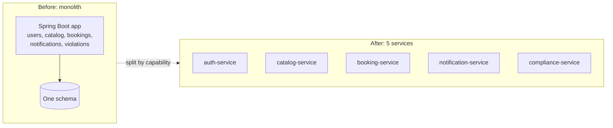

## 3. System architecture

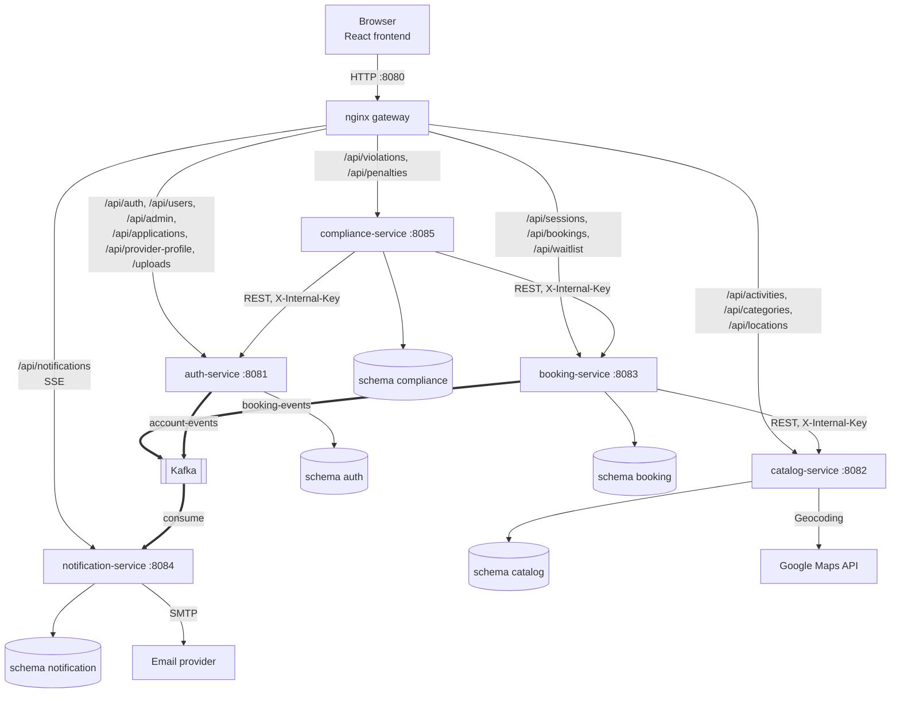

Key points:

- **Gateway** routes by path prefix only. `/api/internal/**` is deliberately not routed, so internal endpoints are unreachable from outside.
- **Synchronous calls** (REST) are used where the caller needs an answer: booking asks catalog for activity data; compliance asks auth and booking.
- **Asynchronous calls** (Kafka) are used for side effects: emails and in-app notifications.
- **Authentication**: auth-service issues a JWT. Every service validates it with the shared `JWT_SECRET`.
- **Service-to-service security**: internal endpoints require the `X-Internal-Key` header (`INTERNAL_API_KEY`).

## 4. Services

| Service | Port | Responsibility | Schema | Tables |
|---|---|---|---|---|
| auth-service | 8081 | Registration, login (JWT), roles, provider applications, profiles, audit log | `auth` | users, tokens, audit_logs, provider_applications, provider_profiles |
| catalog-service | 8082 | Categories, locations (geocoded), activities; cached reads | `catalog` | categories, locations, activities |
| booking-service | 8083 | Sessions, bookings, waitlist, seat allocation, concurrency control | `booking` | sessions, bookings, waitlist |
| notification-service | 8084 | Kafka consumer, in-app notifications (SSE), email | `notification` | notifications, processed_events |
| compliance-service | 8085 | Violations, strikes, penalties | `compliance` | violations, penalties, violation_counters |

### Internal calls

| Caller | Callee | Endpoint | Purpose |
|---|---|---|---|
| booking-service | catalog-service | `GET /api/activities/{id}` | Read activity data when creating sessions |
| compliance-service | auth-service | `GET /api/internal/users/{id}` | Look up the offender |
| compliance-service | auth-service | `PUT /api/internal/users/{id}/status` | Deactivate or blacklist after a strike |
| compliance-service | booking-service | `GET /api/internal/sessions/{id}` | Check the reporter owns the session |
| compliance-service | booking-service | `POST /api/internal/providers/{id}/cancel-upcoming-sessions` | After a provider strike (best effort) |

## 5. Data architecture

One database `bookngo`, one schema per service. Flyway migrations live in each service and create their own schema. A service never reads another service's tables.

Columns that point to another service (for example `bookings.user_id`) are plain `BIGINT` values with no foreign key. `bookings.user_email` is a snapshot so that events carry everything a consumer needs.

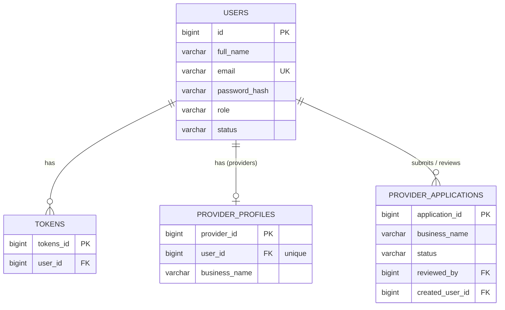

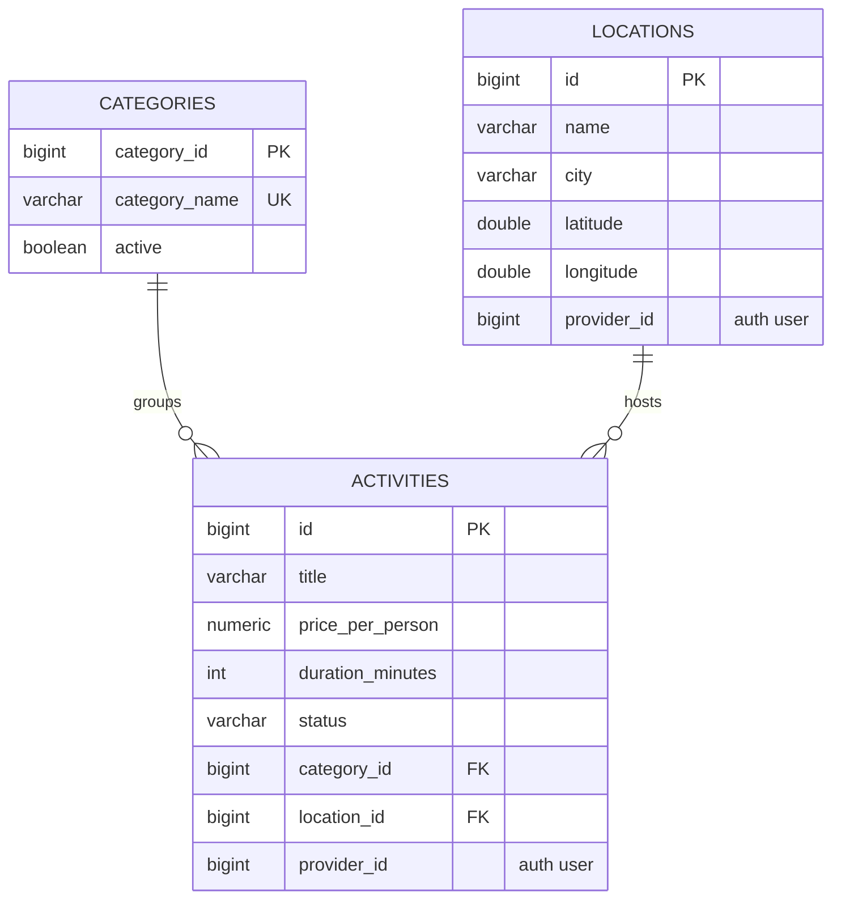

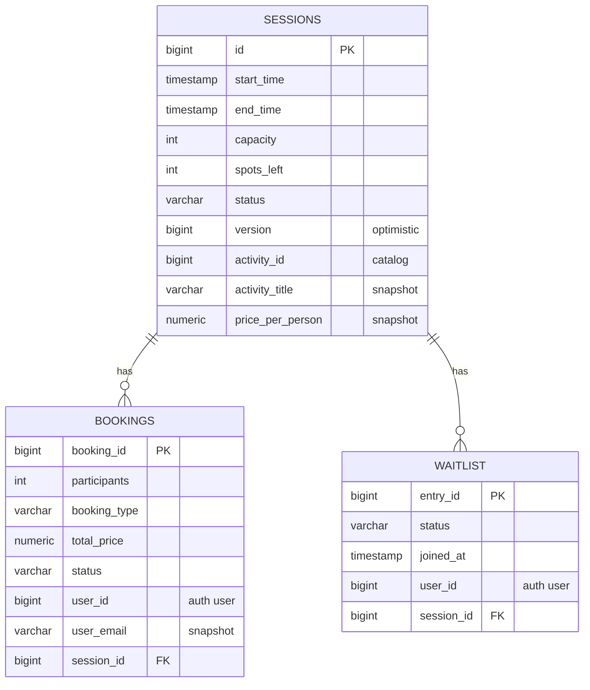

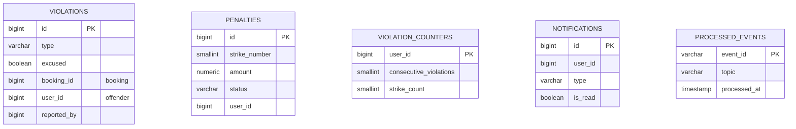

Database-level guarantees in booking-service:

- `ux_bookings_active`: unique `(user_id, session_id)` where status is `CONFIRMED` – a user cannot hold two active bookings for one session.
- `ux_waitlist_waiting`: unique `(user_id, session_id)` where status is `WAITING`.
- `sessions.version`: optimistic version column on top of the pessimistic lock.

## 6. Key workflows

### 6.1 Booking a session and notifying the customer

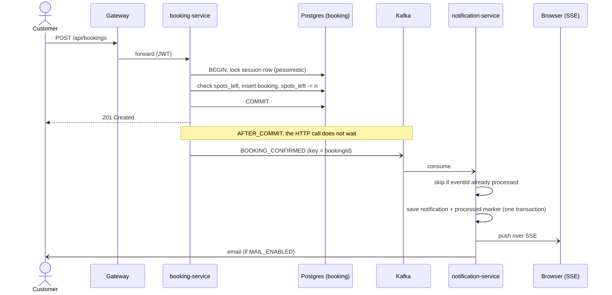

### 6.2 Cancellation and waitlist allocation

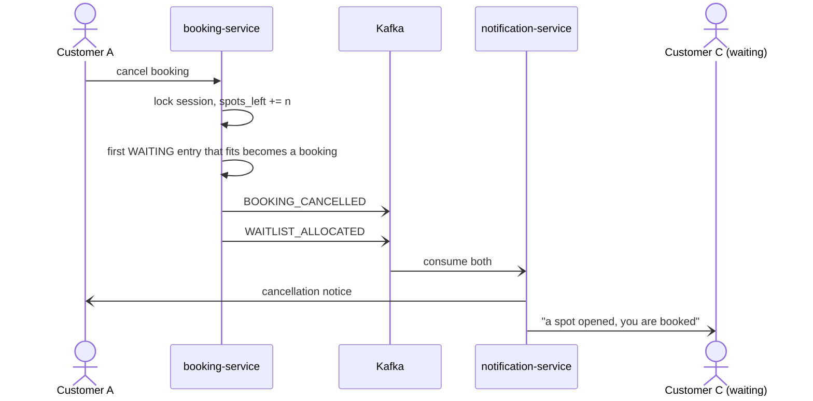

### 6.3 Violation, strike and penalty

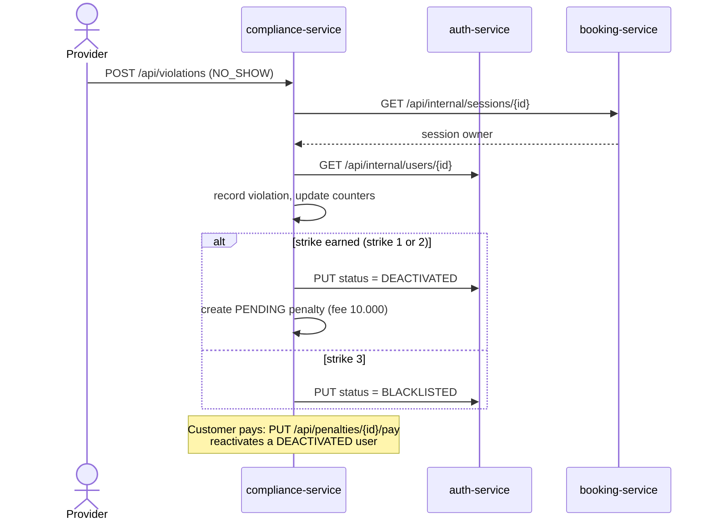

Rules: strikes 1 and 2 need three unexcused violations in a row; after two strikes a single violation is a strike; strike 3 blacklists with no penalty. Excused violations are recorded but do not count. Three provider cancellations in a row give a provider strike and cancel upcoming sessions.

## 7. State models

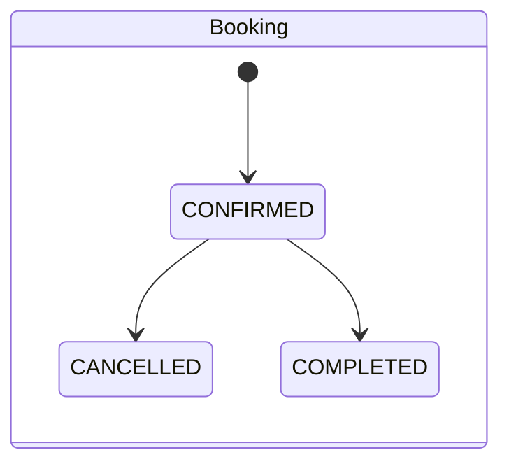

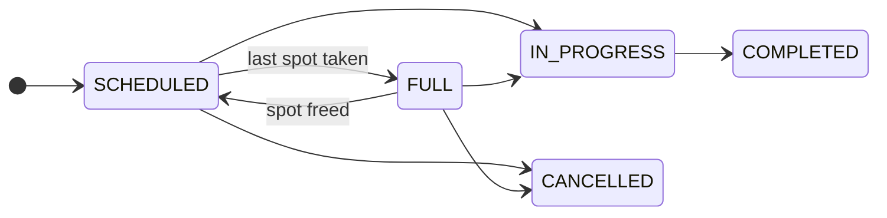

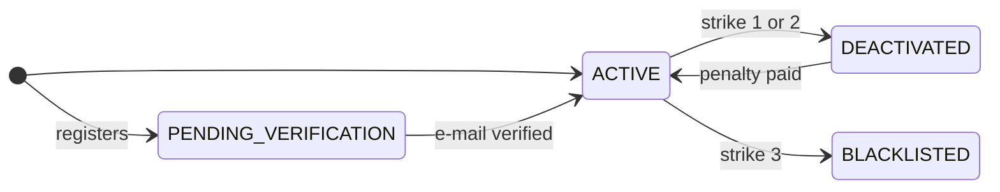

Waitlist entries: `WAITING → BOOKED | CANCELLED | EXPIRED`. Penalties: `PENDING → PAID`. Provider applications: `PENDING → APPROVED | REJECTED`.

## 8. Cross-cutting concerns

| Concern | Decision |
|---|---|
| Concurrency | Pessimistic lock on the session row while seats change; unique indexes as a second line of defence |
| Caching | Caffeine cache-aside in catalog-service, TTL and size from env (`CACHE_TTL_SECONDS`, `CACHE_MAX_SIZE`); evicted after writes. Limitation: per-instance, so replicas can serve stale data until TTL expires; Redis would remove this |
| Messaging | Producers publish after commit; consumer is idempotent; failures go to dead-letter topics (see [kafka-events.md](kafka-events.md)) |
| Security | BCrypt passwords, JWT, role checks, internal key, login rate limit (5 per minute per IP), secrets only in environment variables |
| Observability | Spring Actuator health on every service; container logs shipped to CloudWatch (`awslogs` driver) |
| Schema evolution | Flyway migrations per service |
| Packaging | Multi-stage Dockerfile, runs as non-root user, JRE-only runtime image |

## 9. Technology stack

Java 17, Spring Boot, Spring Data JPA, Spring Security (JWT), Spring Kafka, Spring Cache with Caffeine, Flyway, PostgreSQL 16.4, Apache Kafka 3.9.1 (KRaft), nginx 1.27, React (Vite), Docker and Docker Compose, Jenkins, AWS (EC2, RDS, CloudWatch), Docker Hub.

## 10. Known limitations

- Kafka runs as a single broker (replication factor 1), adequate for this project but not fault tolerant.
- The cache is per-instance (see above).
- Penalty payment is simulated; there is no payment gateway.
- Provider-session cancellation after a strike is best effort and is not retried.
