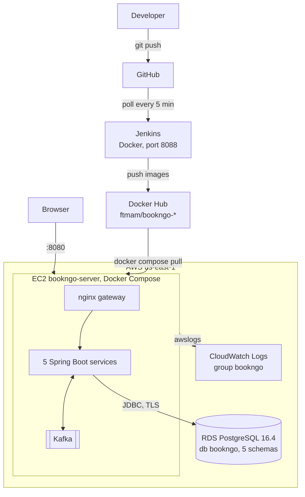
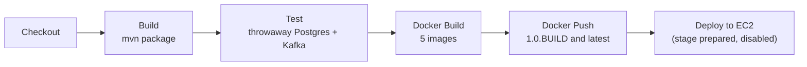

# BookNGo – Deployment

How BookNGo is built, shipped and run: locally with Docker Compose, and in production on AWS (EC2 + RDS) with Jenkins and Docker Hub.

Related: [architecture.md](architecture.md) · [kafka-events.md](kafka-events.md)

## 1. Environments

| | Local | Production (AWS) |
|---|---|---|
| Compose file | `docker-compose.yml` | `docker-compose.prod.yml` (copied to `/opt/bookngo/docker-compose.yml`) |
| Database | Postgres container | Amazon RDS PostgreSQL 16.4, private, `sslmode=require` |
| Images | Built locally | Pulled from Docker Hub `ftmam/bookngo-<service>:<tag>` |
| Kafka | Container, host listener for debugging | Container, internal listener only |
| Logs | `docker compose logs` | CloudWatch log group `bookngo` (`awslogs` driver) |
| Entry point | `http://localhost:8080` | `http://<EC2 public IP>:8080` |

## 2. Production topology



Network rules (security groups):

| Group | Inbound | Source |
|---|---|---|
| `bookngo-app-sg` (EC2) | 22 (SSH) and 8080 (HTTP) | Restricted to the admin's IP |
| `bookngo-db-sg` (RDS) | 5432 | `bookngo-app-sg` only |

RDS is not publicly accessible. Only the EC2 instance can reach it.

## 3. CI/CD pipeline



| Stage | What it does |
|---|---|
| Checkout | Pulls `main` (SCM poll every 5 minutes) |
| Build | Maven build of all modules |
| Test | Runs the test suite against throwaway Postgres 16.4 and Kafka 3.9.1 containers |
| Docker Build | One image per service from the shared multi-stage `Dockerfile` (`--build-arg SERVICE=<module>`) |
| Docker Push | Pushes `1.0.<BUILD_NUMBER>` and `latest` using the Jenkins credential `dockerhub` (an access token, never the account password) |
| Deploy to EC2 | SSH deploy stage, written but commented out until the SSH Agent plugin and credentials `ec2-ssh-key` and `ec2-host` are configured |

Jenkins runs in Docker (`bookngo-jenkins:lts-jdk17`, port 8088, volume `jenkinsvol-bookngo`). Setup details: [`jenkins/README.md`](../jenkins/README.md). A GitHub Actions workflow (`.github/workflows/ci.yml`) is kept as an optional extra.

## 4. Configuration and secrets

Nothing secret is committed. The server reads `/opt/bookngo/.env` (created by hand, not in Git). The committed template is `.env.prod.example`.

| Variable | Purpose |
|---|---|
| `RDS_HOST` | RDS endpoint hostname |
| `DB_USERNAME`, `DB_PASSWORD` | Database login (password only in a password manager and the server `.env`) |
| `JWT_SECRET` | Shared token signing key (random, 32+ bytes) |
| `INTERNAL_API_KEY` | Key for service-to-service calls |
| `IMAGE_TAG` | Image version to run, for example `1.0.6` |
| `MAIL_ENABLED`, `MAIL_USERNAME`, `MAIL_PASSWORD` | Email delivery (off by default) |
| `FRONTEND_URL` | Base URL used in email links |
| `GOOGLE_MAPS_API_KEY` | Geocoding for locations |
| `SEED_ENABLED`, `SEED_PASSWORD` | One-time demo data seeding; keep `SEED_ENABLED=false` afterwards |
| `CACHE_TTL_SECONDS`, `CACHE_MAX_SIZE` | Optional catalog cache tuning |

Compose refuses to start if a required variable is missing (`${VAR:?message}`).

## 5. First-time setup on AWS

1. **RDS**: create PostgreSQL 16.4 `bookngo-db`, private, self-managed master password, security group `bookngo-db-sg`. Create the database `bookngo`.
2. **EC2**: Amazon Linux 2023, security group `bookngo-app-sg`, IAM role with CloudWatch Logs permission.
3. **Docker on the host**:
   ```bash
   sudo dnf install -y docker
   sudo systemctl enable --now docker
   sudo usermod -aG docker ec2-user
   ```
   Install the Compose plugin and log in again.
4. **Project folder**:
   ```bash
   sudo mkdir -p /opt/bookngo/gateway && sudo chown -R ec2-user /opt/bookngo
   ```
   Copy `docker-compose.prod.yml` as `/opt/bookngo/docker-compose.yml` and `gateway/nginx.conf` to `/opt/bookngo/gateway/`.
5. **Secrets**: create `/opt/bookngo/.env` from `.env.prod.example` and fill it in.
6. **Check the connection** from the EC2 shell: `psql "host=$RDS_HOST dbname=bookngo user=postgres sslmode=require"`.
7. **Start**:
   ```bash
   cd /opt/bookngo
   docker compose config -q
   docker compose pull
   docker compose up -d
   ```

Flyway creates the schemas and tables on first start.

## 6. Releasing a new version

1. Merge to `main`. Jenkins builds, tests and pushes `1.0.<n>`.
2. On the server:
   ```bash
   cd /opt/bookngo
   sed -i 's/^IMAGE_TAG=.*/IMAGE_TAG=1.0.<n>/' .env
   docker compose pull
   docker compose up -d
   ```
3. Verify (section 7).

**Rollback**: set `IMAGE_TAG` back to the previous version and repeat `pull` and `up -d`. Database migrations are forward-only, so a rollback across a migration needs a compatible migration.

## 7. Verify and operate

```bash
docker compose ps                         # all services healthy
curl -s http://localhost:8080/health      # gateway: ok
curl -s http://localhost:8080/api/categories | head -c 300
docker compose logs --tail 50 booking-service
```

Every service exposes `/actuator/health`, used by the Compose health checks. Start order is enforced with `depends_on: condition: service_healthy` (Kafka first, then catalog and auth, then booking, then compliance, then the gateway).

CloudWatch: open **CloudWatch → Log groups → `bookngo`**; each container has its own stream.

## 8. Seeding demo data

1. In `/opt/bookngo/.env` set `SEED_ENABLED=true` and a `SEED_PASSWORD`, then `docker compose up -d auth-service`. The seeder creates one admin, two providers and three customers (only if no users exist).
2. From a machine with Node 18+: `API_URL=http://<host>:8080 SEED_PASSWORD=... node scripts/seed-demo-data.mjs`. It creates locations, activities, sessions and bookings through the public API, and is safe to run twice.
3. Set `SEED_ENABLED=false` and run `docker compose up -d auth-service` again.

## 9. Scaling and the concurrency demo

Services are stateless, so booking-service can run several replicas. The pessimistic row lock in Postgres keeps seat counts correct across instances:

```bash
docker compose up -d --scale booking-service=2
```

The gateway currently points at the service name, so Docker DNS spreads connections between replicas. The catalog cache is per instance (see [architecture.md](architecture.md), section 8).

## 10. Limitations and next steps

- Single EC2 host and single Kafka broker; no high availability.
- Plain HTTP on port 8080; HTTPS needs a domain and a certificate (ALB or Let's Encrypt).
- Deploy stage in Jenkins is prepared but not yet enabled.
- No Elastic IP confirmed, so the public IP may change after a stop/start.
- Ingress is limited to one admin IP, which must be updated when the network changes.
