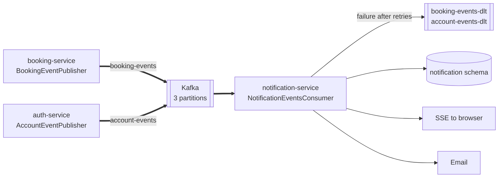
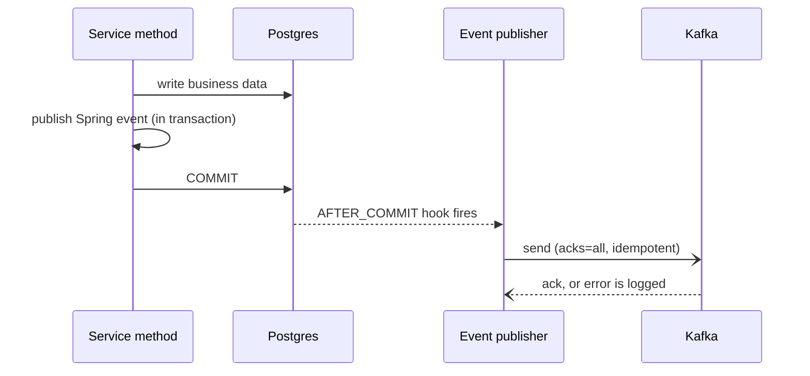
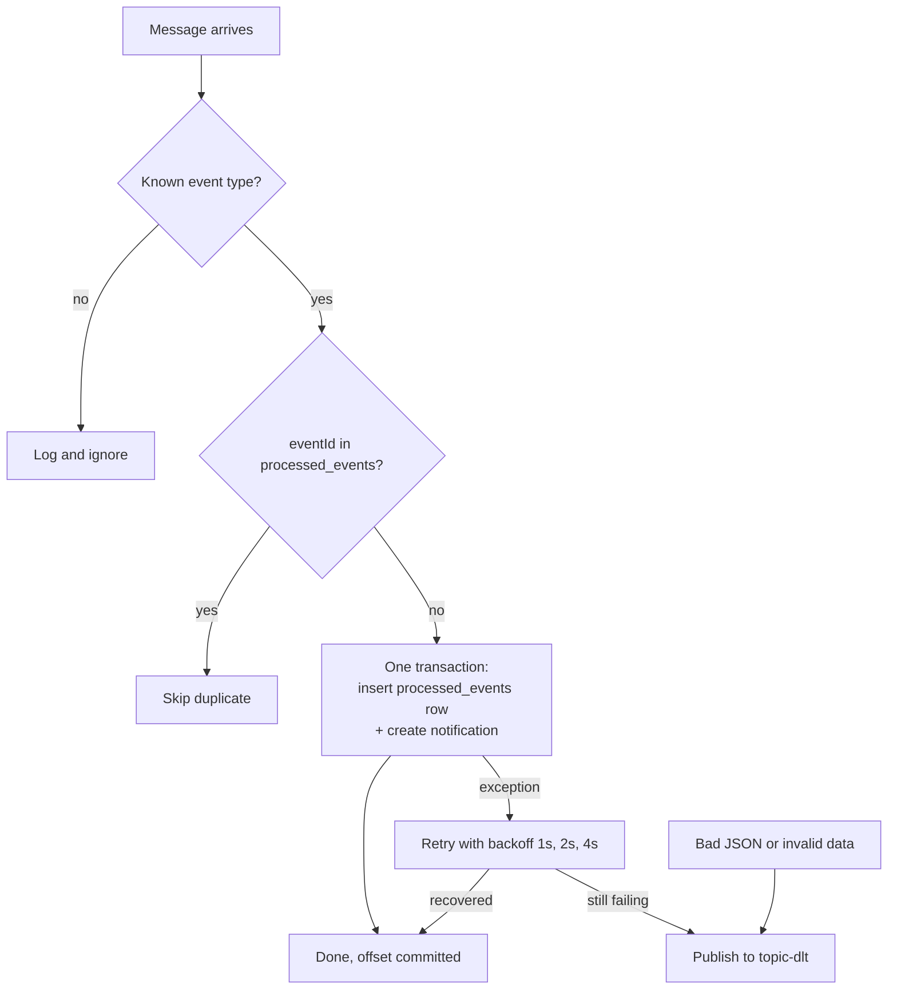

# BookNGo – Kafka Events

Two producers publish domain events; one consumer (notification-service) turns them into in-app notifications and emails. Producers never wait for the consumer, so a slow mail server cannot slow down a booking or a registration.

Related: [architecture.md](architecture.md) · [deployment.md](deployment.md)

## 1. Overview



## 2. Topics

| Topic | Producer | Consumer | Key | Partitions | Replication |
|---|---|---|---|---|---|
| `booking-events` | booking-service | notification-service | `bookingId` | 3 | 1 |
| `account-events` | auth-service | notification-service | recipient `userId` | 3 | 1 |
| `booking-events-dlt` | notification-service (error handler) | none (inspection) | original | 3 | 1 |
| `account-events-dlt` | notification-service (error handler) | none (inspection) | original | 3 | 1 |

The key keeps all events for one booking (or one user) on the same partition, so they are consumed in order. Broker auto-creation of topics is disabled; each service declares its topics. The broker is Apache Kafka 3.9.1 in KRaft mode (no ZooKeeper).

## 3. Event types and payloads

### booking-events

| Event type | When it is published | Notification created |
|---|---|---|
| `BOOKING_CONFIRMED` | A booking is saved | `BOOKING_CONFIRMED` |
| `BOOKING_CANCELLED` | A booking is cancelled | `BOOKING_CANCELLED` |
| `WAITLIST_ALLOCATED` | A waitlisted customer gets a freed seat | `WAITLIST_ALLOCATED` |

Payload (`BookingEvent`):

| Field | Type | Notes |
|---|---|---|
| eventId | string | UUID, unique per event; used for idempotency |
| eventType | enum | see above |
| occurredAt | instant | |
| bookingId, userId, sessionId, activityId | long | |
| userEmail | string | snapshot |
| activityTitle | string | snapshot |
| startTime | local date-time | session start |
| participants | int | |
| bookingType | string | `INDIVIDUAL` or `GROUP` |
| totalPrice | decimal | |

The event is a full snapshot, so the consumer never calls booking-service.

### account-events

| Event type | When it is published | Notification created |
|---|---|---|
| `USER_REGISTERED` | A user registers | `EMAIL_VERIFICATION` |
| `PASSWORD_RESET_REQUESTED` | Forgot-password request | `PASSWORD_RESET` |
| `PROVIDER_APPLICATION_SUBMITTED` | A provider applies (one event per admin) | `NEW_PROVIDER_APPLICATION` |
| `PROVIDER_APPLICATION_APPROVED` | Admin approves | `PROVIDER_APPLICATION_APPROVED` |
| `PROVIDER_APPLICATION_REJECTED` | Admin rejects | `PROVIDER_APPLICATION_REJECTED` |

Payload (`AccountEvent`): `eventId`, `eventType`, `occurredAt`, `recipientUserId`, `recipientEmail`, and optional `token` (verification or reset token), `businessName`, `contactName`, `city`, `proposedActivities`, `reviewNote`. Fields that do not apply to a type are null.

## 4. Producer guarantees



- Events are sent only **after the database commit** (`@TransactionalEventListener(AFTER_COMMIT)`). A rolled-back booking never produces an event.
- The producer uses `acks=all` and idempotence, so retries do not create duplicates inside Kafka.
- Trade-off: if Kafka is down at the exact moment after commit, the event is logged as failed and not retried. A transactional outbox table would close this gap; it is listed as future work.

## 5. Consumer guarantees

Kafka delivers at least once, so the same event can arrive twice. The consumer handles that explicitly.



| Mechanism | Detail |
|---|---|
| Idempotency | `processed_events` table keyed by `eventId`; the marker and the notification are written in one transaction |
| Concurrent duplicates | The primary key rejects the second insert; it rolls back and is skipped on retry |
| Retry | Exponential backoff starting at 1 s, multiplier 2, 3 attempts (`app.kafka.retry.attempts`) |
| Non-retryable errors | `IllegalArgumentException` and `NullPointerException` go straight to the dead-letter topic |
| Dead letters | `<topic>-dlt`, same partition as the source; keeps the failed message and does not block the partition |
| Unknown event types | Ignored, so producers can add new types without breaking the consumer |
| Consumer groups | One listener per topic (`notification-booking-events`, `notification-account-events`) |

## 6. How to inspect Kafka

Run on the EC2 host (or locally with the same service name). The broker listens on `kafka:29092` inside the Compose network.

```bash
cd /opt/bookngo

# topics
docker compose exec kafka /opt/kafka/bin/kafka-topics.sh \
  --bootstrap-server localhost:29092 --list

# last events on booking-events
docker compose exec kafka /opt/kafka/bin/kafka-console-consumer.sh \
  --bootstrap-server localhost:29092 --topic booking-events \
  --from-beginning --max-messages 5

# dead letters (should normally be empty)
docker compose exec kafka /opt/kafka/bin/kafka-console-consumer.sh \
  --bootstrap-server localhost:29092 --topic booking-events-dlt \
  --from-beginning --timeout-ms 5000

# producer and consumer log lines
docker compose logs booking-service notification-service | grep -E "Published|Consumed|duplicate"
```

Log lines to look for: `Published BOOKING_CONFIRMED eventId=… to booking-events-<partition>@<offset>` and `Consumed BOOKING_CONFIRMED eventId=… from booking-events-<partition>@<offset>`.

## 7. Demo script (1 minute)

1. Open the notification bell in the browser as customer1.
2. Book a session as customer2 in another window.
3. Show the `Published` and `Consumed` log lines side by side.
4. Cancel a booking on a full session and show the waitlisted customer receiving a `WAITLIST_ALLOCATED` notification.
